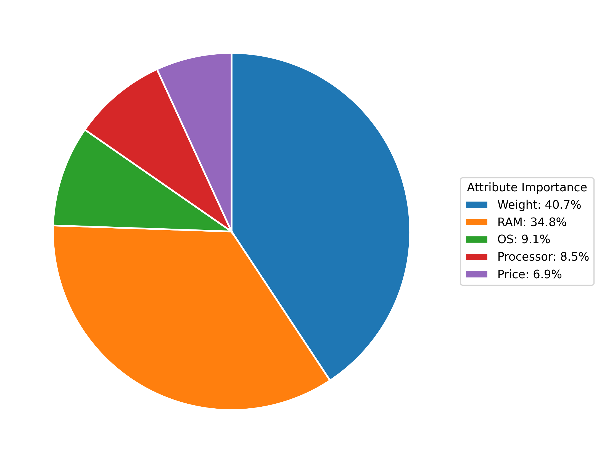

# Laptop Consumer Preferences: A Conjoint Analysis

## Project overview

This project uses survey-based conjoint analysis to identify the laptop features that most influence consumer preference. Respondents ranked 10 laptop profiles, each defined by five attributes: price, RAM, processor, weight, and operating system.

## Approach

The survey rankings were reshaped into a profile-level dataset and combined with the laptop design matrix. Part-worth utilities and relative attribute importance were then calculated to quantify how each product attribute affects preference. A linear-regression model was also fitted to assess how closely predicted preferences aligned with the observed rankings.

## Key findings

- **Weight** was the most influential attribute, contributing **40.7%** of total preference importance.
- **RAM** was the second most influential attribute at **34.8%**.
- Together, weight and RAM accounted for **75.5%** of the decision-making importance measured in the study.
- Operating system (**9.1%**), processor (**8.5%**), and price (**6.9%**) had comparatively smaller effects on preference.
- The model's predicted and actual profile preferences showed a moderate, statistically significant relationship (Spearman **rho = 0.636**, *p* = **0.0479**).

## Conclusion

The results indicate that product configuration should focus primarily on the weight and RAM combinations. While price, processor, and operating system remain relevant, they played a substantially smaller role in the rankings. The validation result suggests that the conjoint model captures overall preference patterns reasonably well and can support early product-design decisions.
